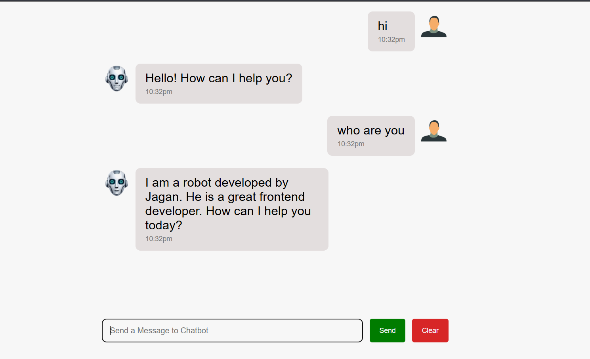

Features

Interactive and user-friendly chatbot interface.

User and chatbot message display.

AI robot avatar and user profile avatar.

Automatic welcome message when the chatbot starts.

Automated chatbot responses.

Chatbot self-introduction feature.

Message timestamps for sent and received messages.

User message input field.

Send button to submit messages.

Clear button to clear the conversation.

Chat history display.

Separate message bubbles for users and chatbot responses.

Clean and attractive user interface.

Easy-to-use chat functionality.

